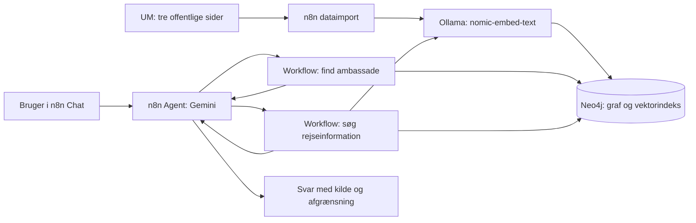

# Rejseassistent med n8n Agents og Neo4j

Uofficiel studieprototype til danske rejsende. Agenten finder en dansk ambassades adresse i en struktureret graf og søger rejseinformation i tekstafsnit med embeddings. Casen er afgrænset til **Spanien** med tre kilder fra Udenrigsministeriet. Japan bruges som negativ test. Systemet må ikke erstatte officielle rejseoplysninger.

Agenten er bygget i **n8n Agents**, bruger **Gemini 3.1 Flash Lite** og vælger mellem to n8n-workflowværktøjer. Data, vektorer og strukturerede relationer ligger i samme Neo4j-database. Dette er **retrieval augmented generation (RAG)**: modellen trænes ikke på ny.

## Find afleveringskravene her

| Krav | Filer og dokumentation |
|---|---|
| Case, agentens rolle og arkitektur | Denne README og [arkitektur og datamodel](docs/architecture.md) |
| Læsbare workflowoversigter | [Screenshotoversigt](docs/screenshots/README.md): dataimport, grafopslag og vektorsøgning |
| n8n workflow JSON | [01-data-ingestion.json](workflows/01-data-ingestion.json), [02-graph-retrieval.json](workflows/02-graph-retrieval.json), [03-vector-retrieval.json](workflows/03-vector-retrieval.json) |
| Model, instruktioner, værktøjer og skills | [Agentkonfiguration](agent/configuration.json), [instruktioner](agent/instructions.txt), [grafværktøj](agent/tool-1-description.txt), [søgeværktøj](agent/tool-2-description.txt), [skills](agent/skills.txt), [udviklingsprompts](agent/development-prompts.md) |
| Tre spørgsmål, opslag, faktiske svar og vurdering | [Testresultater](examples/RESULTS.md) og [maskinlæsbare traces](examples/raw/) |
| Datakilder og lille prøve | [Kildeliste](data/sources.json), [pas-eksempel uden vektorer](data/sample.json), [fuldt snapshot med vektorer](data/snapshot.json) |
| Genskab data, graf og indeks | [Opsætning](docs/SETUP.md), [schema.cypher](neo4j/schema.cypher), [Python-scripts](scripts/), [valideringsrapport](docs/validation.json) |

## Sådan hænger komponenterne sammen

Dataimporten læser HTML, renser tekst, bevarer kilde/land/emne/dato, deler teksten i chunks og gemmer 768-dimensionelle embeddings. Den opretter også lande- og ambassadenoder. Grafværktøjet følger `Document → Embassy → Country`. Søgeværktøjet kombinerer vektorsøgning, landefilter, en dokumenteret emneprioritering og grafopslag af nabochunks.

## Status ved aflevering

- Afprøvet med n8n **2.45.7**, Neo4j **2026.09.0 / Cypher 25** og Ollama **0.40.0**.
- Snapshot: **3 dokumenter, 20 chunks, 1 land og 1 ambassade**; vektorindekset `chunk_embedding` er online.
- Importen er kørt to gange uden dubletter. Snapshot-gendannelse er også testet to gange i en separat database.
- Begge workflowværktøjer og agenten er publiceret i den lokale n8n-installation. JSON-eksporterne importeres inaktive, så modtageren først kan tilknytte egne credentials.
- API-nøgler, adgangskoder, n8n-database og private backupfiler er **ikke** med i repoet. Agentens konfiguration er en tekstspecifikation, der genskabes i Agents-builderen; den er ikke en n8n-workflowimport.

**Begrænsning:** Et vellykket værktøjskald er ikke bevis på et korrekt AI-svar. Pastesten viser fortsat overfortolkning og en upræcis downloadhenvisning. Den tidligere søgefejl og de resterende problemer er bevaret i [evalueringen](examples/RESULTS.md). Prototypen dækker ikke alle lande, opdateres kun ved genkørsel og er ikke produktionsklar.

Start med [opsætningen](docs/SETUP.md), eller læs [de tre faktiske testresultater](examples/RESULTS.md).
