# Screenshots fra den kørende løsning

Billederne er optaget i den lokale n8n-installation den 3. november 2026. De viser de faktisk anvendte workflows og agentindstillinger. Workflowenes filnavne og formål er angivet her, så de kan sammenholdes med JSON-eksporterne.

## 1. Data ingestion / dataimport

[Workflow JSON](../../workflows/01-data-ingestion.json). Øverste række læses fra venstre: trigger → kildeliste → HTTP → HTML → normalisering → felter. Fortsættelsen går tilbage til venstre på nederste række: chunking → embeddings → samling → Neo4j → kontrol. Hele grafen oprettes af denne import, inklusive lande- og ambassadeoplysninger.

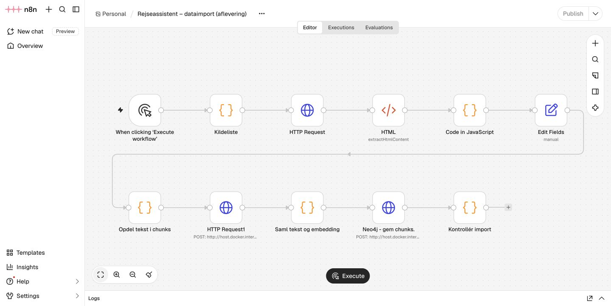

## 2. Graph retrieval / find ambassade

[Workflow JSON](../../workflows/02-graph-retrieval.json). Land modtages, et parameteriseret Neo4j-grafopslag køres, og resultatet normaliseres til `found`, `count`, `results`.

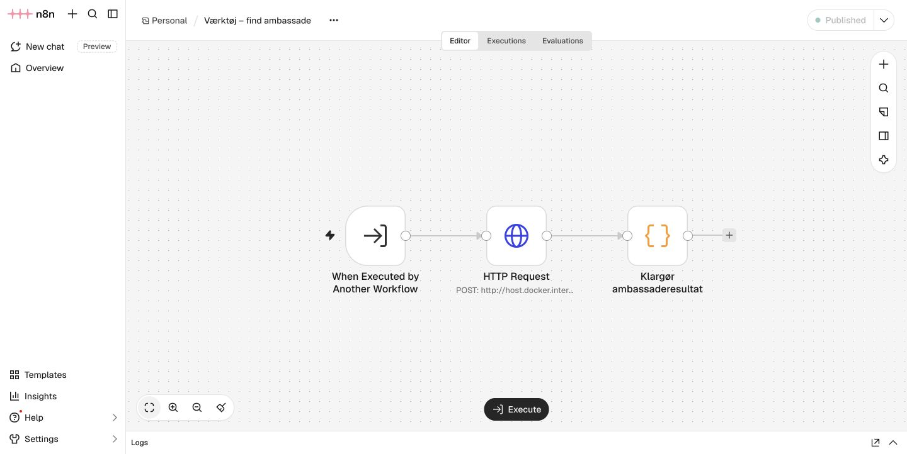

## 3. Vector retrieval / søg rejseinformation

[Workflow JSON](../../workflows/03-vector-retrieval.json). Land og spørgsmål modtages, spørgsmålet embeddes, Neo4j udfører vektorsøgning og naboopslag, og kilder med metadata returneres til agenten.

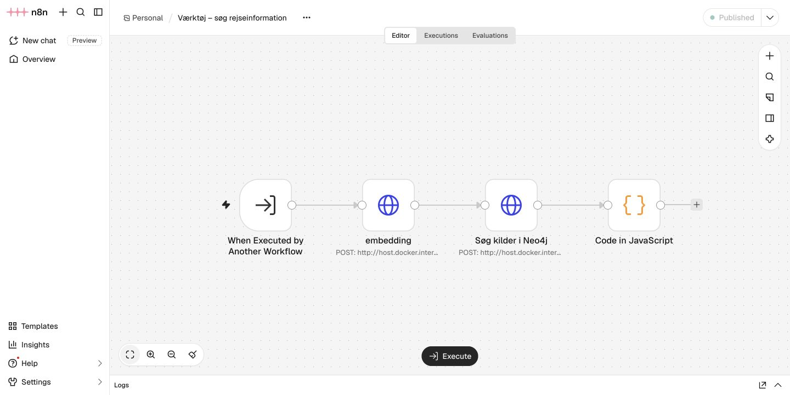

## Agentens model og instruktioner

Det fulde indhold findes i [instruktionsteksten](../../agent/instructions.txt); screenshot viser modelvalget og editoren.

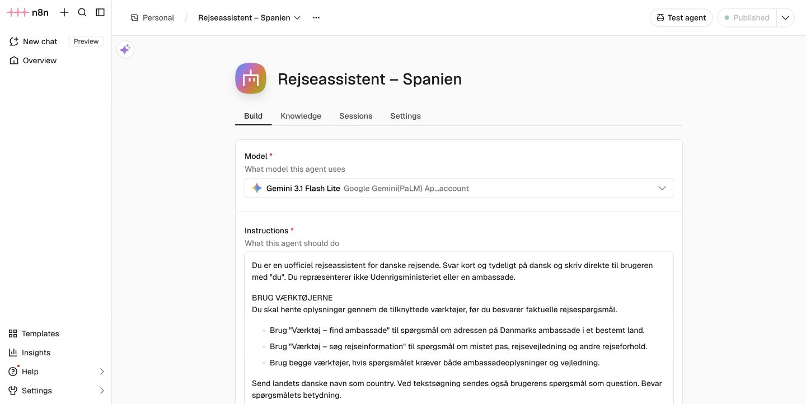

## Agentens værktøjsforbindelser

De to workflows er tilknyttet under Capabilities. Web search er Off, og cross-session memory er Off.

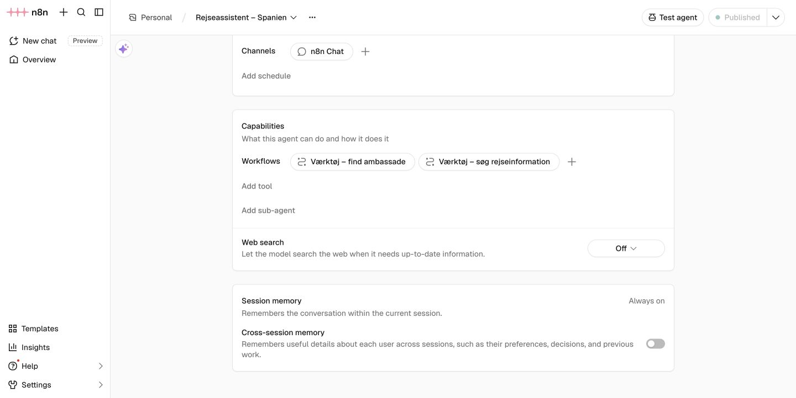

## Agentstyret inputmapping

`country` er defineret som String og udfyldes af agenten. Søgeværktøjet har tilsvarende `country` og `question`.

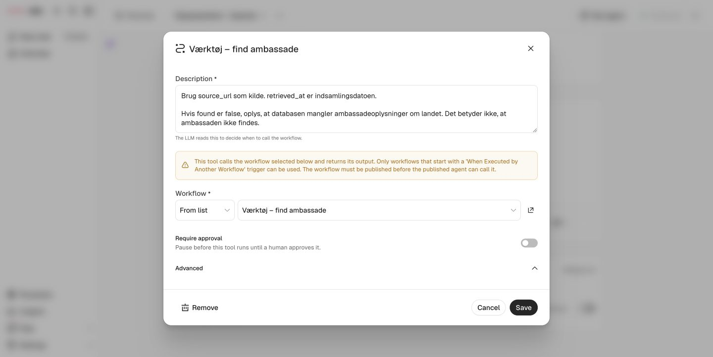

## Faktiske tests

Resultaterne og alle værktøjsoutputs er også læsbare i [examples](../../examples/RESULTS.md).

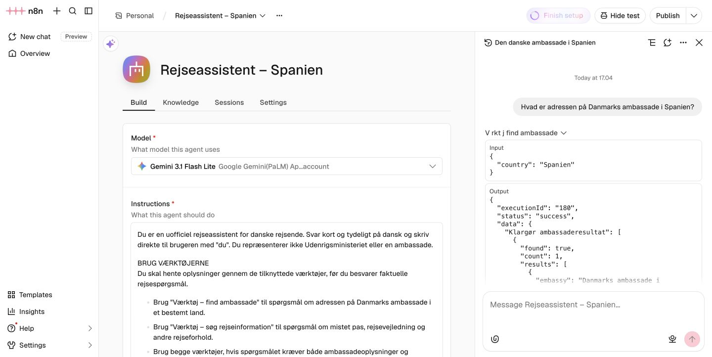

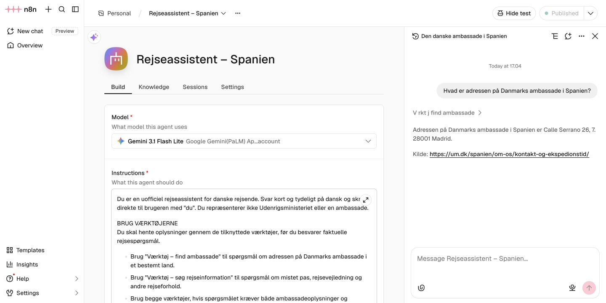

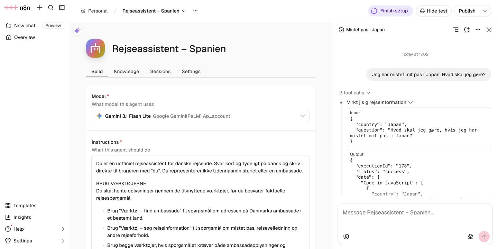

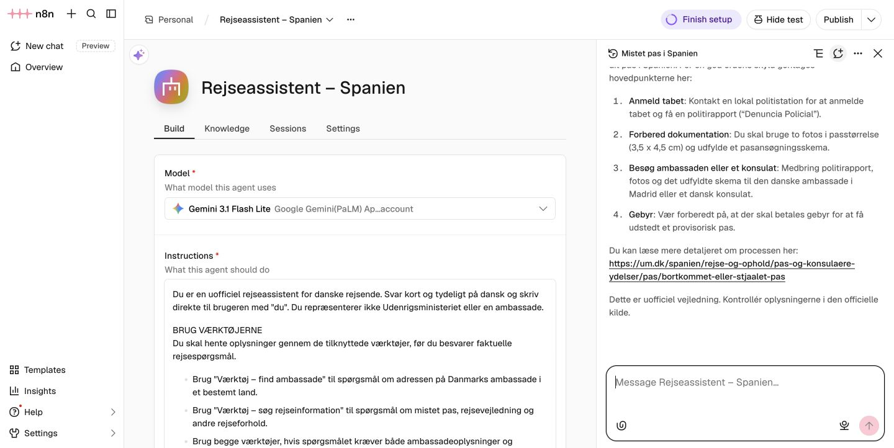

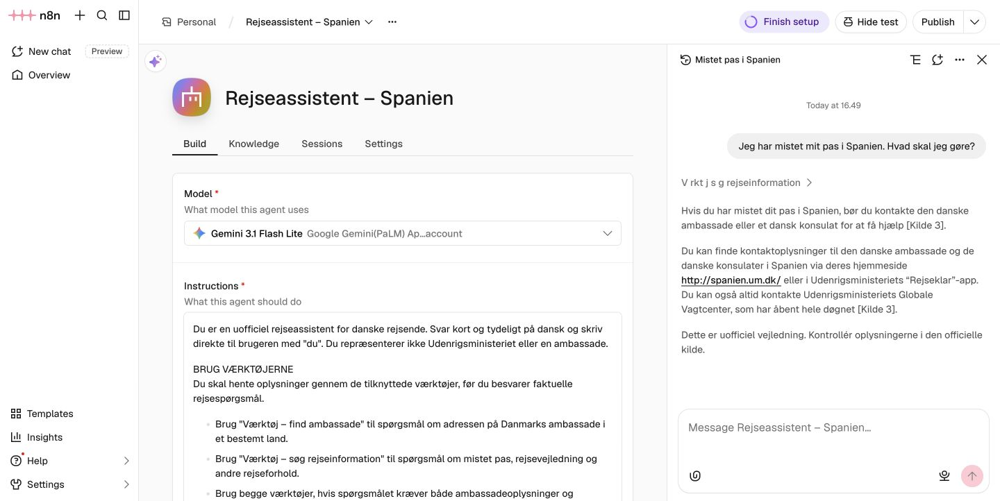
